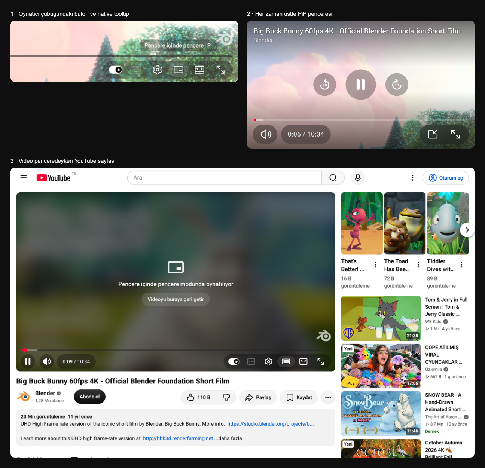

<div align="center">

# 🎬 MSSoft YouTube PiP

**YouTube oynatıcısına yerleşen, her zaman üstte duran pencere içinde pencere.**

Butona bas, video sayfadan çıksın; diğer sekmelerin ve uygulamaların üstünde oynamaya devam etsin.

[](LICENSE)
[](test/extension.test.js)
[](package.json)
[](SECURITY.md)
[](manifest.json)
[](#-kurulum)

[Kurulum](#-kurulum) · [Kullanım](#-kullanım) · [Ayarlar](#-ayarlar) · [macOS ve tam ekran](#-macos-ve-tam-ekran-uygulamalar) · [Güvenlik](#-güvenlik) · [English](#-english)

</div>



---

## Sorun

YouTube'un mini oynatıcısı sekmeden çıkamaz. Chrome'un kendi pencere içinde pencere modu ise çıplak bir video karesi: başlık yok, ilerleme çubuğu yok, ses yok, 10 saniye atlama yok.

## Çözüm

Oynatıcının kontrol çubuğuna YouTube'un kendi butonu gibi görünen bir **pencere içinde pencere** butonu eklenir. Basınca YouTube'un gerçek `<video>` öğesi, Document Picture-in-Picture API ile açılan her zaman üstte bir pencereye **taşınır**. Oynatma, kalite, reklam ve sonraki video yine YouTube'un kendi oynatıcısı tarafından yönetilir; pencere YouTube tarzı tam bir kontrol seti sunar.

## Özellikler

- **Native buton.** YouTube'un 2025 oynatıcısındaki sağ kapsülde, sinema modunun soluna (eskiden mini oynatıcının durduğu yere) yerleşir. YouTube'un kendi `ytp-button` sınıflarını, hover efektini ve tooltip öğesini kullanır; tooltip'te `P` kısayol çipi görünür.
- **Gerçek, her zaman üstte pencere.** Pencereyi ekranın istediğin yerine sürükle, kenarlarından büyüt. Son genişlik hatırlanır, pencere videonun en-boy oranında açılır.
- **YouTube tarzı kontroller.** Başlık ve kanal adı, oynat / duraklat, ±10 sn (ayarlanabilir), kırmızı-pembe gradyanlı ilerleme çubuğu (zaman balonu, sürükleyerek arama), ses düğmesi ve kaydırıcısı, süre, sekmeye dön, tam ekran. Kontroller 2,5 sn hareketsizlikten sonra gizlenir, duraklatınca görünür kalır.
- **Video sayfadan kalkar.** Oynatıcıda bulanık küçük resim, "Pencere içinde pencere modunda oynatılıyor" yazısı ve "Videoyu buraya geri getir" düğmesi görünür.
- **Tam ekrana dönüş.** Penceredeki tam ekran düğmesi (veya `F` / çift tık) videoyu sekmeye geri getirip YouTube'un kendi tam ekranını açar.
- **Akıllı davranışlar.** Başka videoya geçince başlık güncellenir ve video oynamaya devam eder. Reklamda ilerleme çubuğu sarıya döner, arama kapanır. Canlı yayında `CANLI` rozeti çıkar; tıklayınca yayının en güncel anına gidilir. Sayfada tam ekrana geçersen video otomatik geri gelir. Pencerenin ✕ düğmesi Chrome'un kendi PiP'i gibi videoyu duraklatır.
- **Tam ekran uygulamalara uyum (macOS).** Başka bir uygulamanın tam ekran alanına geçince pencere görünmez olur (bkz. [macOS ve tam ekran uygulamalar](#-macos-ve-tam-ekran-uygulamalar)); isteğe bağlı olarak video orada duraklar, geri dönünce kaldığı yerden sürer.
- **Küçük pencerelere uyum.** Pencere küçüldükçe düzen sadeleşir; çok kısa pencerelerde oynat ve ±10 düğmeleri alt çubuğa taşınır.
- **Dil.** Arayüz YouTube'un dilini izler (TR, EN, DE, FR, ES, RU).
- **Gömülü videolar.** Başka sitelere gömülü YouTube videolarında buton sağ üstteki simge sırasına eklenir. Tarayıcılar iframe içinden Document PiP'e izin vermediği için orada klasik video PiP kullanılır.
- **Sıfır bağımlılık, sıfır ağ trafiği, tek izin.** Ayrıntı [Güvenlik](#-güvenlik) bölümünde.

## 🚀 Kurulum

### Kaynaktan (geliştirici modu)

1. Bu depoyu indir: `git clone https://github.com/lastref/mssoft-youtube-pip.git` (veya **Code → Download ZIP**).
2. Tarayıcıda `chrome://extensions` (Brave: `brave://extensions`, Edge: `edge://extensions`) adresini aç.
3. Sağ üstten **Geliştirici modu**'nu aç.
4. **Paketlenmemiş öğe yükle**'ye bas, klasörü seç.
5. Açık YouTube sekmelerini yenile.

Chrome, Brave, Edge, Opera, Arc ve Vivaldi'de çalışır. **Chromium 116 veya üstü** gerekir (Document Picture-in-Picture API). Firefox ve Safari bu API'yi sunmadığı için desteklenmez.

### Paketli sürüm

```bash
npm run package
```

`dist/mssoft-youtube-pip-<sürüm>.zip` üretir; yalnızca çalışma zamanı dosyalarını içerir (Chrome Web Store'a yüklenen paket budur). Aynı zip her CI çalışmasında da artefakt olarak üretilir.

## ⌨️ Kullanım

| Nerede | Kısayol | İşlev |
|---|---|---|
| YouTube sayfası | `P` | Pencere içinde pencereyi aç / kapat |
| PiP penceresi | `Boşluk` / `K` | Oynat / duraklat |
| PiP penceresi | `J` / `L` | Ayarlanan süre kadar geri / ileri (varsayılan 10 sn) |
| PiP penceresi | `←` / `→` | 5 sn geri / ileri |
| PiP penceresi | `↑` / `↓` | Ses aç / kıs |
| PiP penceresi | `M` | Sesi kapat / aç |
| PiP penceresi | `F` veya çift tıklama | Sekmeye dön ve tam ekran yap |
| PiP penceresi | `P` | Sekmeye dön |
| PiP penceresi | `0`–`9` | Videonun %0–90'ına git |
| PiP penceresi | `Home` / `End` | Başa / sona git |
| PiP penceresi | `Shift + N` | Sonraki video |

## ⚙️ Ayarlar

Araç çubuğundaki eklenti simgesine tıkla:

- **Oynatıcı butonu:** dört ikon stili.
  - **YouTube** (varsayılan): YouTube'un oynatıcıda gizli tuttuğu kendi PiP glifi.
  - **Dışarı aç:** köşeden çıkan ok.
  - **Yüzen:** diğer pencerelerin üstündeki pencere.
  - **Ayır:** çerçeveden taşan küçük pencere.
- **İleri / geri atlama:** 5, 10, 15 veya 30 sn.
- **Klavye kısayolu:** `P` tuşunu açar veya kapatır.
- **Sekme değiştirince aç** (deneysel): Chrome'un otomatik pencere içinde pencere özelliğiyle, oynayan bir videonun sekmesinden çıkınca pencere kendiliğinden açılır.
- **Tam ekran uygulamalar → Tam ekran uygulama pencereyi gizleyince duraklat:** macOS'ta başka bir uygulamanın tam ekran alanına geçtiğinde video, görünmeden oynamak yerine duraklar; pencere yeniden görünür olunca kaldığı yerden sürer. Varsayılan: kapalı (ses devam eder).

Ayarlar `chrome.storage.sync` ile tarayıcı hesabında eşitlenir; pencere genişliği cihazda kalır.

## 🖥 macOS ve tam ekran uygulamalar

**Durum:** PiP penceresi macOS masaüstlerinin (Spaces) hepsinde ve tarayıcının kendi tam ekran pencerelerinin üstünde görünür; ancak **başka bir uygulamanın** (Xcode, Word, Terminal, bir oyun…) tam ekran alanına geçince görünmez. Video oynamaya devam eder, sadece pencere o alanda yoktur. Bu, bir eklentinin değiştirebileceği bir şey değildir; neden ve ne yapılabileceği aşağıda.

### Neden

macOS, bir uygulamanın tam ekran alanında başka uygulamaların pencerelerini göstermez. Tek istisna, Dock'ta görünmeyen ajan uygulamaları ve `.nonactivatingPanel` türünde paneller için `canJoinAllSpaces` + `fullScreenAuxiliary` davranışıdır. Chromium ise PiP penceresini (hem Document PiP hem klasik video PiP) şöyle açar:

| | Chromium | Tam ekran alanında görünmek için gereken |
|---|---|---|
| Pencere sınıfı | `NSWindow` (`NativeWidgetMacFramelessNSWindow`) | `NSPanel` + `.nonactivatingPanel` **veya** ajan uygulama |
| Seviye | `kCGFloatingWindowLevel` (3) | floating ✓ |
| `collectionBehavior` | `CanJoinAllSpaces \| Managed \| ParticipatesInCycle` | `canJoinAllSpaces` + `fullScreenAuxiliary` |
| Web / eklenti API'si | `requestWindow()` yalnızca `width`, `height`, `disallowReturnToOpener`, `preferInitialWindowPlacement` alır; `chrome.windows.alwaysOnTop` salt okunur; ilgili bayrak veya politika yok | — |

Kaynak: `chrome/browser/ui/views/picture_in_picture/document_pip_host.cc` ve `chrome/browser/ui/views/overlay/video_overlay_window_views.cc` (`z_order = kFloatingWindow`, `visible_on_all_workspaces = true`), `ui/gfx/mac/nswindow_frame_controls.mm` (`SetNSWindowVisibleOnAllWorkspaces` yalnızca `CanJoinAllSpaces` ekler). Chromium'un `FullScreenAuxiliary` ekleyen tek yolu olan `SetCanAppearInExistingFullscreenSpaces()` PiP için hiç çağrılmaz. Chrome 147'den (Nisan 2026) beri `MoveToActiveFullscreenSpace()` yalnızca **Chrome'un kendi** penceresi tam ekrana girince PiP'i o alana taşır.

### Doğrulama

11 Ekim 2026, macOS 27.0, Brave 154 (Chromium 154). Başka bir uygulama tam ekrandayken `CGWindowListCopyWindowInfo(kCGWindowListOptionOnScreenOnly)` ile ekranda olan pencereler ve PiP belgesinin `document.visibilityState` değeri:

| Pencere | Görünür mü |
|---|---|
| Document PiP (bu eklenti) | ❌ `hidden` |
| Klasik video PiP (`requestPictureInPicture`) | ❌ |
| Ajan uygulama, floating, `canJoinAllSpaces` | ✅ |
| Ajan uygulama, floating, `canJoinAllSpaces + fullScreenAuxiliary` | ✅ |
| Normal (Dock'lu) uygulama, floating, `canJoinAllSpaces` | ❌ |
| Normal uygulama, floating, `canJoinAllSpaces + fullScreenAuxiliary` | ❌ |
| Tarayıcının **kendi** penceresi tam ekrandayken Document PiP | ✅ |

### Ne yapabilirsin

1. **Tam Ekran yerine Doldur.** Pencerenin yeşil düğmesine `⌥` ile tıkla (ya da **Pencere → Doldur** / `fn ⌃ F`). Uygulama ekranı kaplar ama yeni bir alan açılmaz; PiP üstte kalır. Çoğu kullanıcı için asıl çözüm budur.
2. **Tarayıcının kendi tam ekranı.** Chrome/Brave penceresini tam ekran yaparsan PiP onunla birlikte gelir.
3. **İkinci ekran.** *Sistem Ayarları → Masaüstü ve Dock → "Ekranların ayrı alanları var"* açıkken bir ekrandaki tam ekran uygulama diğer ekranı etkilemez; PiP öbür ekranda kalır.
4. **Duraklat ayarı.** Görünmeyen videonun sesini istemiyorsan eklenti ayarlarından *Tam ekran uygulama pencereyi gizleyince duraklat*'ı aç.

## 🔧 Nasıl çalışıyor

Eklenti YouTube'un `<video>` öğesini **taşır**, kopyalamaz. Video Document PiP penceresine taşınır, kapanınca eski yerine döner. YouTube öğeye referansla bağlı kaldığı için oynatma, arabelleğe alma, kalite ve sonraki video YouTube'un kendi oynatıcısı tarafından yönetilmeye devam eder; sayfadaki YouTube kontrolleri de çalışmayı sürdürür.

```
manifest.json            MV3, tek izin: storage, sıkı CSP
src/
  background.js          sekmeyi / pencereyi öne getirir (yalnızca kendi mesajları)
  content/
    main-world.js        YouTube oynatıcı API'si köprüsü (başlık, ses, sonraki video)
    shared.js            DOM yardımcıları (Trusted Types: innerHTML yok), köprü istemcisi
    icons.js             buton stilleri ve PiP penceresi ikonları
    i18n.js              YouTube diline göre metinler
    pip-styles.js        PiP penceresinin CSS'i
    pip-window.js        PiP penceresindeki oynatıcı arayüzü
    content.js           buton, tooltip, aç/kapat, yer tutucu, kısayollar, görünürlük
    page.css             youtube.com'a eklenen stiller
  popup/                 ayarlar penceresi
_locales/                eklenti adı ve ayar metinleri (TR, EN)
icons/                   eklenti ikonları
test/                    node --test paketi (20 test, bağımlılık yok)
scripts/package.js       dağıtım zip'i
.github/workflows/ci.yml her push'ta test + zip artefaktı
```

## 🔒 Güvenlik

En az yetki, sıfır ağ trafiği, sıfır veri toplama. 12 korumanın tamamı test paketinde değişmez olarak kilitlidir:

- Tek izin (`storage`); host izni, `tabs`, `scripting` yok.
- Yalnızca `https://www.youtube.com/*` ve `https://www.youtube-nocookie.com/embed/*`.
- Eklenti sayfalarında `default-src 'none'` CSP; inline script yok, uzak kod yok.
- `fetch`/`XMLHttpRequest` yok; eklenti hiçbir sunucuya bağlanmaz.
- Trusted Types uyumlu DOM; `innerHTML`/`eval` yok.
- Arka plan mesajları yalnızca kendi eklenti kimliğinden ve YouTube origin'inden kabul edilir.
- MAIN-world köprüsü: JSON string, şema doğrulama, yöntem beyaz listesi, prototype pollution koruması.
- Video kimliği ve font bağlantısı doğrulaması.
- Telemetri, analitik, tanımlayıcı yok. `web_accessible_resources` ve `externally_connectable` yok.

Ayrıntı ve tehdit modeli: [SECURITY.md](SECURITY.md) · Gizlilik: [PRIVACY.md](PRIVACY.md)

## 🧪 Geliştirme

```bash
npm test
```

Node 20+ yeterlidir, bağımlılık kurulmaz. Testler saf yardımcıları, MAIN-world köprüsünü (sahte `document` ile) ve manifest/CSP/i18n değişmezlerini doğrular. CI aynı paketi Node 22 ile çalıştırır ve dağıtım zip'ini artefakt olarak yükler.

Sürüm geçmişi: [CHANGELOG.md](CHANGELOG.md)

## ⚠️ Sınırlamalar

- **Firefox ve Safari desteklenmiyor**: Document Picture-in-Picture API yalnızca Chromium tabanlı tarayıcılarda var.
- **Shorts** oynatıcısında buton yok; Shorts'ta YouTube'un sağ kontrol kapsülü bulunmuyor.
- Pencere elle boyutlandırılırken en-boy oranı kilitlenmez; oran değişirse siyah bant görünür. Bir sonraki açılışta pencere yine videonun oranında açılır.
- macOS'ta başka uygulamaların tam ekran alanında görünmez (yukarıda açıklandı).
- YouTube oynatıcı arayüzünü değiştirirse butonun yeri değişebilir; eklenti hem yeni ("delhi") hem eski oynatıcıyı, hem de yeni gömülü oynatıcıyı tanır.

## 📄 Lisans

[Apache-2.0](LICENSE) · © 2026 MSSOFT. YouTube, Google LLC'nin tescilli markasıdır; bu proje Google veya YouTube ile bağlantılı değildir.

---

## 🇬🇧 English

**MSSoft YouTube PiP** adds a native-looking picture-in-picture button to the YouTube player. Pressing it moves YouTube's real `<video>` element into an always-on-top Document Picture-in-Picture window with YouTube-style controls: title and channel, play/pause, ±10 s (configurable), gradient progress bar with hover time and scrubbing, volume, duration, live badge, ad awareness, back-to-tab and full screen. The page shows a blurred placeholder with a "bring the video back" button while the video is away. Press `P` on YouTube to toggle.

**Install:** clone or download this repo, open `chrome://extensions`, enable *Developer mode*, choose *Load unpacked* and pick the folder. Works in Chrome, Brave, Edge, Opera, Arc and Vivaldi (Chromium 116+). Firefox and Safari lack the Document PiP API. `npm run package` builds the store zip.

**Settings** (toolbar icon): button style (4 icons), skip step (5/10/15/30 s), `P` hotkey, automatic PiP when switching tabs (experimental), and *Pause while a full-screen app hides the window*.

**macOS and full-screen apps.** The PiP window appears on every desktop Space and over the browser's own full-screen windows, but never over **another app's** native full-screen Space. macOS only grants that to agent apps / non-activating panels with `canJoinAllSpaces + fullScreenAuxiliary`; Chromium opens PiP as a plain `NSWindow` at floating level with `CanJoinAllSpaces | Managed | ParticipatesInCycle`, never applies `FullScreenAuxiliary` to PiP, and exposes no web, extension, flag or policy knob for it (`document_pip_host.cc`, `video_overlay_window_views.cc`, `nswindow_frame_controls.mm`). Verified on 2026-10-11 with macOS 27.0 and Brave 154: both Document PiP and classic video PiP vanish from the on-screen window list while another app is full screen, while an agent-app probe window with `canJoinAllSpaces` stays. Workarounds: use **Fill** (`⌥` + green button) instead of Full Screen, make the browser itself full screen, keep PiP on a second display with separate Spaces, or enable the pause setting so the hidden video doesn't keep playing.

**Security:** single `storage` permission, YouTube-only content scripts, strict CSP, no network code, Trusted-Types-safe DOM, validated background messages and MAIN-world bridge, no telemetry. See [SECURITY.md](SECURITY.md) and [PRIVACY.md](PRIVACY.md). 20 zero-dependency tests (`npm test`) lock these invariants; CI runs them on every push.

Apache-2.0 · © 2026 MSSOFT · Not affiliated with Google or YouTube.
